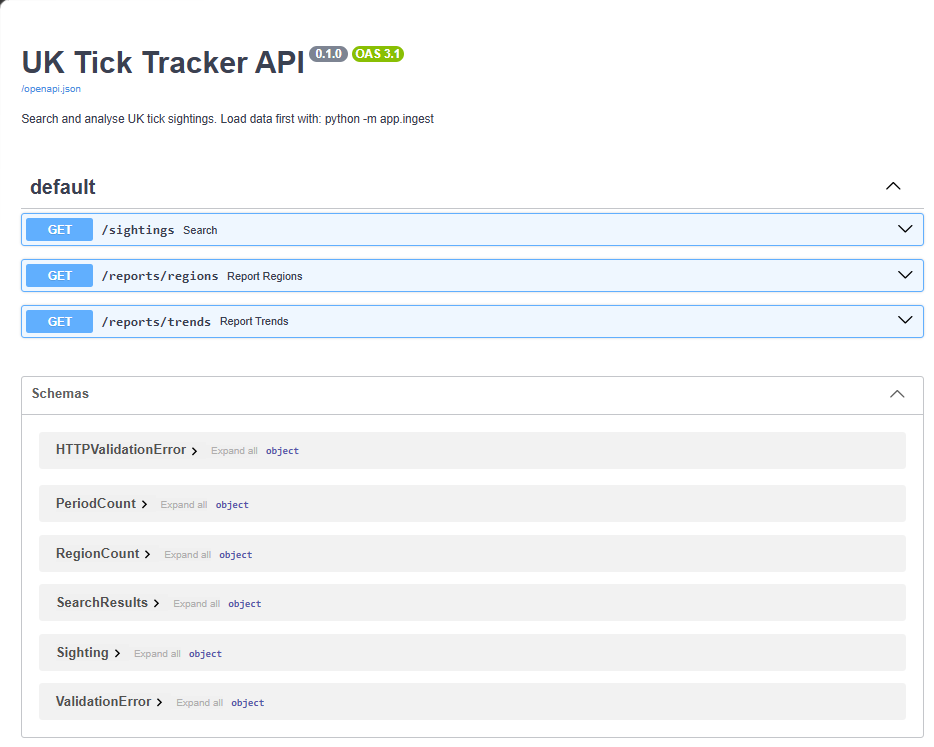
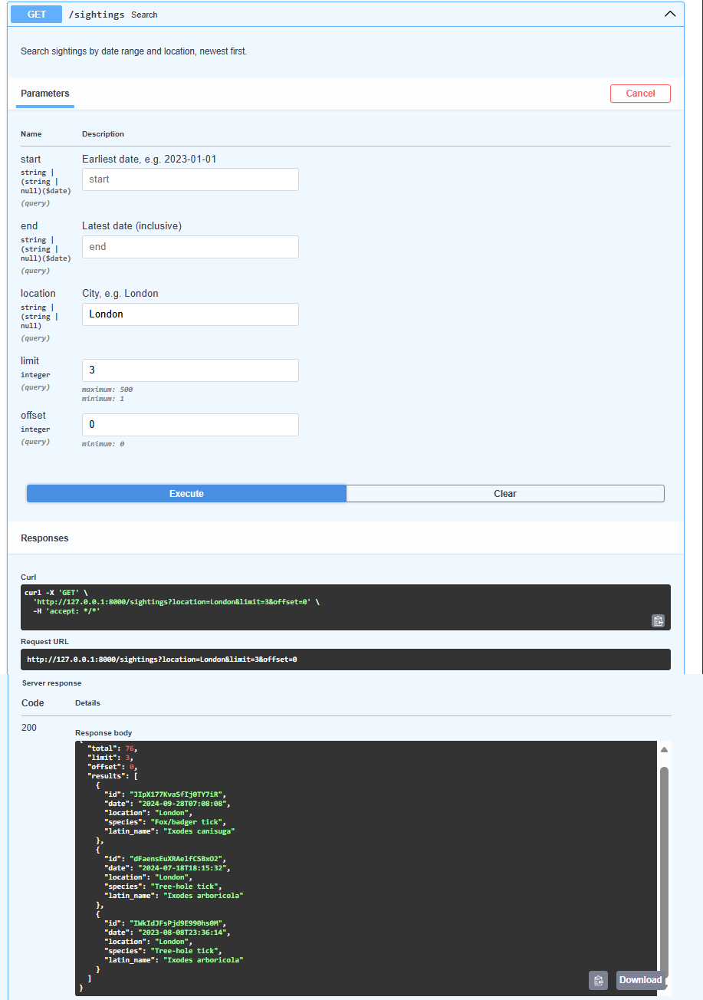
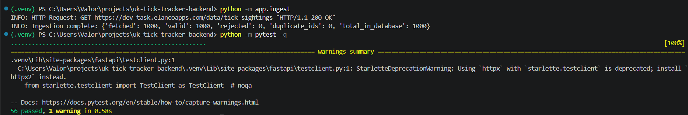

# UK Tick Tracker

**Backend MVP · Elanco Placement Programme technical task (2026)**


A REST API for exploring tick sightings across the UK. It takes the dataset supplied by Elanco, cleans and stores the records, and makes them available through search and reporting endpoints.

I built this as a backend-focused project using **Python, FastAPI and SQLite**. The main aim was to handle the data properly, make it easy to query, and keep the code straightforward to test and explain.

**Author:** Parmbir Singh Nandha  
**Video walkthrough:** *Link to be added before submission*

[Run locally](#run-locally) · [API endpoints](#api-endpoints) · [How it works](#how-it-works) · [Testing](#testing) · [What I'd improve](#what-id-improve)

---

## What it does

- **Imports sightings** from Elanco's API, with timeouts and retries for temporary failures.
- **Cleans the data** before saving it, including missing values, dates and inconsistent city names.
- **Avoids duplicate records** by updating sightings with an existing ID.
- **Searches by date and city**, with pagination for larger result sets.
- **Reports sightings by city and over time**, grouped weekly or monthly.

The API reads from a local SQLite database, not directly from Elanco on every request. Once the import has finished, the search and reporting endpoints can keep working even if the source API is down.

## Run locally

**Requirements:** Python 3.10 or later, Git, and an internet connection for the initial data import. I developed the project on Python 3.14.

**1. Clone the project**

```bash
git clone https://github.com/Valorz1/uk-tick-tracker-backend.git
cd uk-tick-tracker-backend
```

**2. Create a virtual environment**

```bash
python -m venv .venv
```

Activate it on **Windows PowerShell**:

```powershell
.\.venv\Scripts\Activate.ps1
```

Or on **macOS/Linux**:

```bash
source .venv/bin/activate
```

**3. Install dependencies**

```bash
python -m pip install -r requirements.txt
```

**4. Import the sightings**

```bash
python -m app.ingest
```

This creates `ticks.db` in the project root and stores the accepted records. Here's the result from my initial import:

```text
INFO: Ingestion complete: {'fetched': 1000, 'valid': 1000, 'rejected': 0, 'duplicate_ids': 0, 'total_in_database': 1000}
```

Running the import again updates existing IDs rather than adding duplicate rows.

**5. Start the API**

```bash
uvicorn app.main:app --reload
```

Open **http://127.0.0.1:8000/docs** to try the endpoints in FastAPI's interactive documentation.

**6. Run the tests**

```bash
python -m pytest -v
```

> **Getting a `503` response?** The API needs stored sightings first. Run `python -m app.ingest`, then try the request again.

## API endpoints

| Method | Endpoint | Purpose |
|---|---|---|
| `GET` | `/sightings` | Search and filter sightings |
| `GET` | `/reports/regions` | Count sightings by city |
| `GET` | `/reports/trends` | View weekly or monthly counts |

### `GET /sightings`

Search by location, date range, or both. Every filter is optional.

| Parameter | Description | Default |
|---|---|---|
| `start` | Earliest date, inclusive (`YYYY-MM-DD`) | None |
| `end` | Latest date, inclusive (`YYYY-MM-DD`) | None |
| `location` | City name (case and extra spaces ignored) | None |
| `limit` | Page size, between 1 and 500 | `50` |
| `offset` | Number of matching records to skip | `0` |

**Example request**

```http
GET /sightings?location=london&start=2024-01-01&end=2024-12-31&limit=2
```

**Example response**

```json
{
  "total": 2,
  "limit": 2,
  "offset": 0,
  "results": [
    {
      "id": "JIpX177KvaSfIj0TY7iR",
      "date": "2024-09-28T07:08:08",
      "location": "London",
      "species": "Fox/badger tick",
      "latin_name": "Ixodes canisuga"
    },
    {
      "id": "dFaensEuXRAelfCSBxO2",
      "date": "2024-07-18T18:15:32",
      "location": "London",
      "species": "Tree-hole tick",
      "latin_name": "Ixodes arboricola"
    }
  ]
}
```

`total` counts all matching sightings, not just the current page. Results are returned newest first. Searching for a city with no matching records returns an empty list, not an error.

### `GET /reports/regions`

Returns sighting counts by city, highest first. Example excerpt:

```json
[
  {"region": "Nottingham", "count": 95},
  {"region": "Birmingham", "count": 82},
  {"region": "Glasgow", "count": 78}
]
```

The source provides city names rather than counties or administrative regions. I used those cities directly instead of guessing a wider region for each sighting.

### `GET /reports/trends`

Groups sightings by month (default) or week. Weekly periods are labelled using the Monday when that week begins.

```http
GET /reports/trends?period=monthly
GET /reports/trends?period=weekly
```

Monthly example:

```json
[
  {"period": "2024-10", "count": 8},
  {"period": "2024-11", "count": 1},
  {"period": "2024-12", "count": 5}
]
```

Weekly example:

```json
[
  {"period": "2024-12-16", "count": 1},
  {"period": "2024-12-23", "count": 2},
  {"period": "2024-12-30", "count": 1}
]
```

Reports run oldest first. Weeks or months with no sightings aren't included at the moment.

## How it works

```text
                  ┌─────────────────┐
                  │    Elanco API   │
                  └────────┬────────┘
                           │
                           ▼
                  ingest.py  (fetch/retry)
                           │
                           ▼
                  cleaning.py  (validate)
                           │
                           ▼
                      db.py  (upsert)
                           │
                           ▼
                      SQLite database
                           │
                           ▼
                  queries.py  (SQL)
                           │
                           ▼
                  main.py  (FastAPI)
                           │
                           ▼
                       API client
```

I separated the code into small modules, each with one main job:

| File | Responsibility |
|---|---|
| `app/ingest.py` | Fetches records, retries temporary failures and reports import results |
| `app/cleaning.py` | Validates records and standardises dates and city names |
| `app/db.py` | Sets up SQLite and inserts or updates sightings |
| `app/queries.py` | Runs search and aggregation queries |
| `app/models.py` | Defines the response shapes using Pydantic |
| `app/main.py` | Provides the API routes and database dependencies |

### Handling the data

Every incoming record goes through `clean_record()` before it is saved. The required fields are `id`, `date`, `location` and `species`; the Latin name is optional. Dates must be valid, not in the future, and without a timezone, matching the source data's format. City names are tidied so searches use the same spelling rules as stored records.

Invalid records are logged and skipped. A bad record doesn't stop the rest of the dataset from being imported.

SQLite uses the sighting `id` as its primary key. If the same ID is imported again, the new record replaces the old one. Records are saved in a transaction so a failed write doesn't leave half a batch stored.

### Why this stack?

I chose **FastAPI** for request validation and its built-in `/docs` interface. **SQLite** keeps the MVP easy to run without setting up a database server and is enough for the dataset provided. **HTTPX** makes it straightforward to work with timeouts, HTTP errors and mocked responses in tests. I used **pytest** to test the main behaviours and failure cases.

## What I found in the dataset

I looked through the source data before building the API. At the time of testing, I found:

| Observation | Result |
|---|---|
| Records returned | 1,000 |
| Locations | 14 UK cities |
| Tick species | 5 |
| Date range | 3 January 2012 – 30 December 2024 |
| Duplicate IDs | None found |
| Missing required fields or invalid dates | None found |

I also made 10 test requests to the source API. All returned HTTP 200, with response times between 0.37 and 0.64 seconds. These were development-time observations, not a guarantee about the API's future availability.

The data looked clean when I tested it, but I still built validation for missing values, invalid dates and duplicate records rather than relying on the source always being perfect.

## Errors and edge cases

- **Fetching:** Requests time out after 10 seconds. Temporary network errors, HTTP 429, server errors and invalid JSON are retried up to three times with increasing delays. Other client errors, such as HTTP 404, stop immediately.
- **Failed imports:** If fetching fails completely, the existing stored data is left unchanged.
- **Validation:** Bad records are rejected with a logged reason; valid records continue through the import.
- **Queries:** User-supplied values go through SQL placeholders rather than being inserted directly into the query string.

| Status | Meaning |
|---|---|
| `422` | Invalid query parameters, such as a date, limit or reporting period |
| `503` | No sightings have been loaded yet |

## Testing

The repository contains **56 test cases** across four test files, including parameterised scenarios:

| Test file | Covers |
|---|---|
| `tests/test_cleaning.py` | Missing fields, bad dates, future dates and location normalisation |
| `tests/test_db.py` | Saving records, duplicate prevention and updates |
| `tests/test_ingest.py` | Retries, failed requests, imports and summary counts |
| `tests/test_api.py` | Filters, pagination, reports and API errors |

The tests use an in-memory SQLite database rather than the real `ticks.db`. HTTPX's `MockTransport` supplies fake responses from Elanco's API, so failures can be tested without having to wait for the real service to break.

```bash
python -m pytest -v
```

## Screenshots

**Interactive API documentation**



**Filtering tick sightings**



**Terminal output**



## What I'd improve

I focused on the core backend requirements first. With more time, I'd revisit a few areas:

- **Larger datasets:** The importer currently downloads the full list before processing it. I'd look at batches and paginated fetching if the source API supported them.
- **Data refresh:** The importer updates and adds records but doesn't remove sightings that disappear from the source. A scheduled refresh would also save having to run it manually.
- **Reporting:** I'd add filters for species, group cities into wider regions, and return zero counts for periods with no sightings.
- **AI/ML extension:** It could be interesting to flag unusual increases in reported sightings. That would need more data and evaluation before treating the results as meaningful; it isn't part of this MVP.

Tick-sighting counts are reports of activity in this dataset, **not** a direct measure of disease risk.

---

**Parmbir Singh Nandha** · Elanco Placement Programme technical task, 2026  
[GitHub](https://github.com/Valorz1) · [LinkedIn](https://www.linkedin.com/in/parmbir-nandha/)
